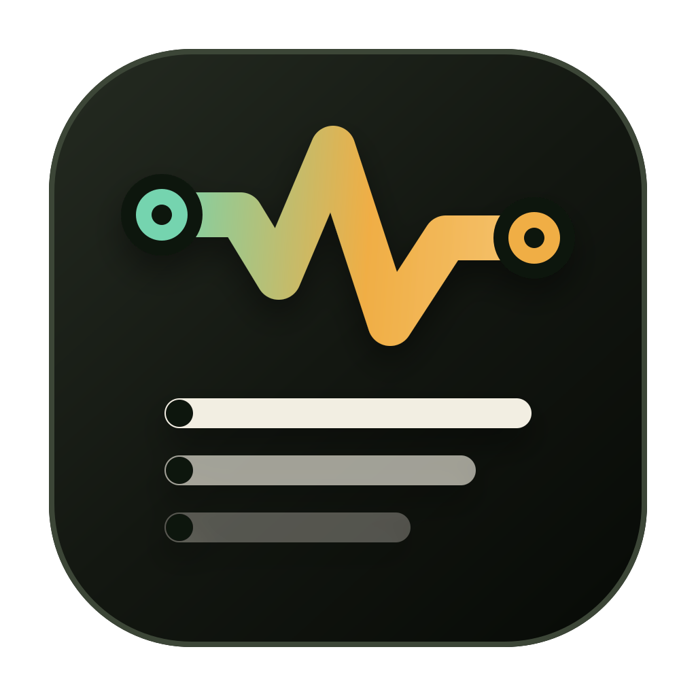

<div align="center">
  
  <h1>LinkDeck</h1>
  <p><strong>A desktop serial/TCP workbench for inspecting frames, sending payloads, and automating device protocols.</strong></p>

  <p>
    <a href="https://github.com/scialpicoody/linkdeck/actions/workflows/ci.yml">
      
    </a>
    <a href="go.mod">
      
    </a>
    <a href="https://bun.sh">
      
    </a>
    <a href="https://mygo.egoist.dev/docs">
      
    </a>
  </p>

  <p>
    <a href="#quick-start">Quick start</a>
    &middot;
    <a href="#scripting">Scripting</a>
    &middot;
    <a href="#configuration">Configuration</a>
    &middot;
    <a href="#development">Development</a>
  </p>
</div>

> [!NOTE]
> LinkDeck is pre-1.0. The workbench is usable, but configuration and scripting interfaces may still evolve.

LinkDeck is a native desktop application for people who debug serial devices and TCP protocols all day. Instead of treating traffic as an endless byte log, it turns each byte stream into complete frames, keeps capture and transmission together, and offers a built-in Lua and sequence automation path when manual poking is not enough.

## Highlights

- **Frame-aware capture.** Configure delimiter, fixed-size, length-prefix, or header/length/checksum framing. Half frames, sticky frames, oversize payloads, and checksum failures are handled before data reaches the UI.
- **Serial and TCP in one workbench.** Work with serial ports, TCP clients, TCP servers, and accepted connections using the same monitor, composer, and inspection model.
- **A monitor built for signal.** Filter by direction, switch between ASCII and HEX, search payloads, pause without losing capture, follow new traffic, and inspect complete frames with session statistics.
- **Fast transmission.** Send ASCII or HEX directly, choose line endings, recall history, and reuse saved Commands across channels.
- **Lua when you need logic.** Script against serial and TCP channels with `send_expect`, `expect`, regex and Lua-pattern matching, plus `log`, `hex`, and `json` helpers.
- **Repeatable sequences.** Build native send/delay/expect programs with repeat, interval, pause, resume, cancellation, and persisted definitions.
- **Local-first configuration.** Presets, favorites, Commands, and Sequences live in one predictable YAML document.

## Quick Start

### Prerequisites

- [Go](https://go.dev/dl/) 1.27.1 or newer
- [Bun](https://bun.sh/)
- The native webview prerequisites for your platform; see the [MyGo documentation](https://mygo.egoist.dev/docs)

### Run from source

```sh
git clone https://github.com/scialpicoody/linkdeck.git
cd linkdeck
bun install
go mod download
bun run dev
```

`bun run dev` starts the native window and the Vite development server. For UI-only work, run `bun run dev:web`; browser mode has no Go host, so bindings and backend events are unavailable.

### Build a desktop app

```sh
bun run build
```

Packaged output is written to `build/`. Use `bun run build`, not plain `go build`: the MyGo build embeds the compiled frontend into the application binary.

## Using LinkDeck

1. Open **Connect** and choose serial, TCP client, or TCP server.
2. Configure the endpoint and framing that match your device or protocol.
3. Watch complete frames in the Monitor, then select a row to inspect its payload and session statistics.
4. Use the operations dock to transmit a one-off payload, run a Sequence, or inspect captured frames.
5. Switch to **Scripts** when a protocol exchange needs state, matching, or custom logic.

LinkDeck keeps channel identity, counters, and frame history when a device is unplugged or a TCP peer disconnects. Reconnect from the retained configuration instead of rebuilding the workspace.

## Scripting

Scripts use an embedded Lua runtime and can open serial or TCP connections directly. A typical request/response exchange looks like this:

```lua
local link = assert(serial.open("/dev/ttyUSB0", {
  baudrate = 115200,
  timeout_ms = 1000,
}))

local reply = assert(send_expect(link, "AT\r", "OK", {
  mode = "prefix",
  timeout_ms = 1000,
}))

log(hex.encode(reply))
serial.close(link)
```

The scripting surface includes:

- `serial.open`, `serial.send`, `serial.recv`, and `serial.close`
- `tcp.open`, `tcp.listen`, `tcp.accept`, `tcp.send`, `tcp.recv`, and `tcp.close`
- Top-level `send_expect` and `expect` with `prefix`, `regex`, and `pattern` modes
- `log`, `hex.encode` / `hex.decode`, and `json.encode` / `json.decode`
- Short source runs, saved-file runs, and long-lived sessions with function calls and auto-reload

Execution is serialized per Lua state. Runs have configurable timeouts, and blocking matcher callbacks are cancellation-aware.

## Configuration

LinkDeck reads the first existing YAML file from this order:

| Priority | Location |
| --- | --- |
| 1 | The path in `LINKDECK_CONFIG` |
| 2 | `config.yaml` beside the executable |
| 3 | The per-user configuration directory |

Per-user locations:

- macOS: `~/Library/Application Support/linkdeck/config.yaml`
- Linux: `~/.config/linkdeck/config.yaml`
- Windows: `%AppData%\linkdeck\config.yaml`

The selected file is authoritative; settings are not merged across layers. A missing file uses built-in defaults, and writes are atomic.

See [`resources/config.example.yaml`](resources/config.example.yaml) for a complete annotated example covering channel presets, script favorites, Commands, and Sequences.

## Architecture

LinkDeck combines a Go application host with a React and TypeScript workbench:

```text
serial / TCP transport
        |
        v
frame extraction
        |
        v
matcher-first script pool
        |
        v
stream queue and status snapshots
        |
        v
mygo events and generated bindings
        |
        v
React workbench
```

The transport, stream, scripting, automation, and frontend layers have separate responsibilities. Framing and codec code remain pure libraries, and the automation engine depends on a small sender interface rather than transport drivers.

| Path | Responsibility |
| --- | --- |
| `main.go` | MyGo app lifecycle, service bindings, events, and window setup |
| `internal/serial`, `internal/tcp` | Transport drivers and connection lifecycles |
| `internal/framing` | Delimiter, fixed-size, length-prefix, and checksum framing |
| `internal/stream` | Per-channel read loops, batching, backpressure, and reset behavior |
| `internal/script` | Lua runtime, sessions, matchers, and opaque channel handles |
| `internal/automation` | Native send/delay/expect execution, timing, and cancellation |
| `internal/link` | Adapters from transport services to script and automation contracts |
| `src/` | React workbench, capture stores, panels, and generated bindings |
| `docs/` | Product design, ADRs, configuration, and primary-source research |

## Development

| Task | Command |
| --- | --- |
| Start the desktop app | `bun run dev` |
| Start browser-only UI | `bun run dev:web` |
| Regenerate Go-to-TypeScript bindings | `bun run generate` |
| Build the packaged app | `bun run build` |
| Lint and format checks | `bun run check` |
| TypeScript checks | `bun run typecheck` |
| Frontend tests | `bun run test` |
| Dead-code checks | `bun run knip` |
| All Go tests | `go test ./...` |

Run a focused Go test with `go test ./internal/framing -run TestDelimiterHalfFrames`. Run a focused frontend test with `bunx vitest run src/lib/channels.test.ts`.

`src/mygo.ts` is generated. Never edit it by hand; change the Go API and run `bun run generate`.

Before opening a pull request, run:

```sh
bun run check
bun run typecheck
bun run test
bun run knip
go test ./...
```

## Project Docs

- [Workbench design](docs/design/workbench.md)
- [Configuration](docs/design/configuration.md)
- [Send and automation design](docs/design/send-automation.md)
- [Visual language ADR](docs/adr/0001-signal-bench-visual-language.md)
- [Domain vocabulary](CONTEXT.md)
- [Agent and contributor guidance](AGENTS.md)

## Contributing

Issues and pull requests are welcome. Open an issue before making substantial changes to the public API, information architecture, or visual language. Use the vocabulary in `CONTEXT.md`, check relevant ADRs and design docs, and include verification details in pull requests.

## License

No license has been declared yet. The source is publicly viewable, but no reuse license is currently granted.
